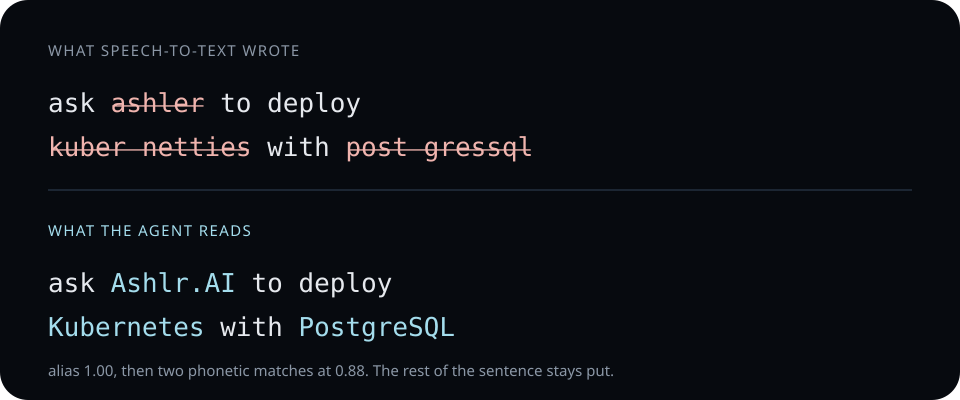
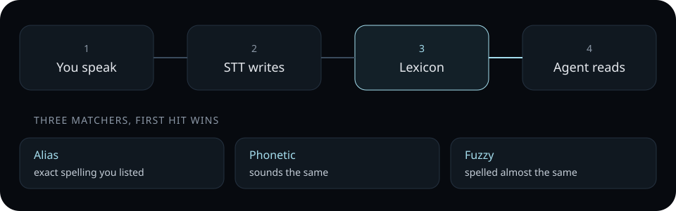
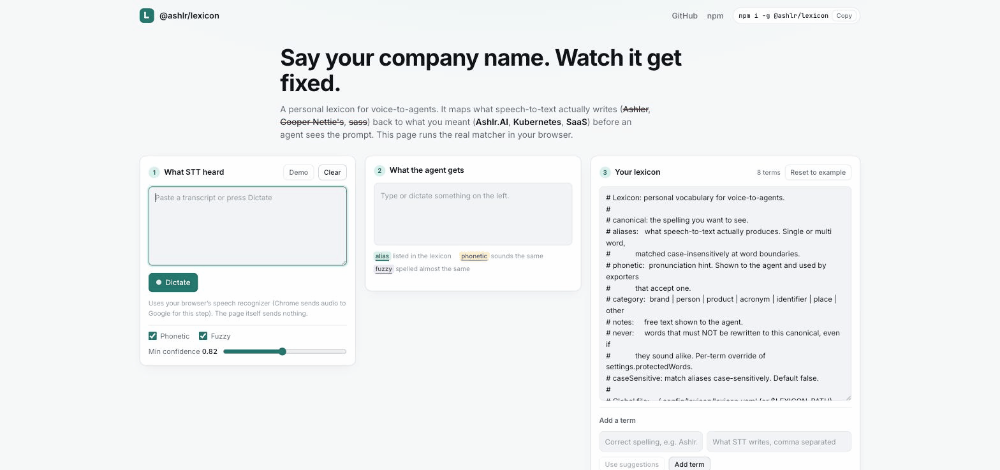
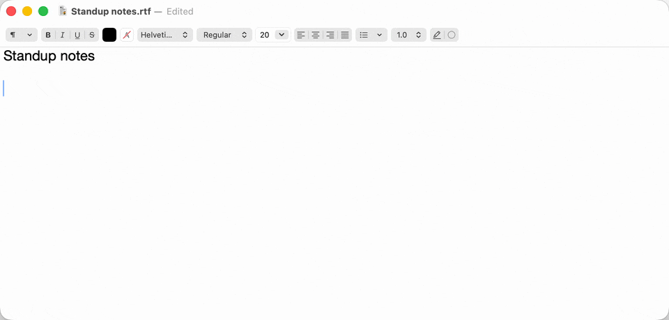

<div align="center">


# Lexicon

**Speech-to-text gets English right and your names wrong.**

Lexicon is one YAML file of the words you actually say. It rewrites the transcript before an agent reads it. It is not a dictation app.

[](https://github.com/ashlrai/lexicon/actions/workflows/ci.yml)
[](https://www.npmjs.com/package/@ashlr/lexicon)
<!-- fresh:begin badge:release -->[](package.json)<!-- fresh:end -->
[](LICENSE)
[](package.json)
[](https://github.com/ashlrai/lexicon/stargazers)
[](https://www.npmjs.com/package/@ashlr/lexicon)
[](https://discord.gg/jBQrSU6XeD)

[**Live demo**](https://ashlrai.github.io/lexicon/) · [**Docs**](docs/README.md) · [**llms.txt**](llms.txt) · [**llms-full.txt**](llms-full.txt) · [**lexicon.ashlr.ai**](https://lexicon.ashlr.ai)

</div>

## Start here (60 seconds)

Install Lexicon with Node.js 20 or newer, add a name and its common mishearing, then try a correction:

```bash
npm install -g @ashlr/lexicon
lexicon add Ashlr.AI Ashler
lexicon normalize "ask Ashler to ship it" --json
```

Lexicon is the voice layer of the [Ashlr.AI ecosystem](#part-of-the-ashlrai-ecosystem): an agent-run software factory where the person dictating is the board member, not the operator.

## Set up for an agent

For guided setup, run `lexicon setup`. Agents should preview the plan and show it before applying it. The preview writes nothing; JSON output starts with `ok`.

```bash
lexicon setup --dry-run --json
lexicon normalize "ask ashler to deploy kuber netties with post gressql" --json
lexicon setup --yes --packs developer,ai --json
```

`--packs`, `--harvest` and `--serve` stay opt-in even with `--yes`, because each writes a lot or installs a service.



Add the spelling, still as JSON:

```bash
lexicon add Ashlr.AI Ashler Ashlar "Ashler AI" --phonetic ASH-ler --json
```

For a scripted add that writes only what you pass, use `lexicon terms add Ashlr.AI --heard Ashler Ashlar --json`: no suggested aliases, refused without `--heard`, and a repeat run answers `"unchanged":true`.

When the user corrects you, record it. `--dry-run` writes nothing.

```bash
lexicon learn --from "it's Ashlr.AI not Ashler" --dry-run --json
```

Check the install. Read `ready`, `summary` and `nextStep`.

```bash
lexicon doctor --json
```

Exit code 0 means every check passed. Exit code 1 means at least one check failed, and the JSON still prints, so read it either way. A fresh machine with no MCP registration exits 1 and names the fix in `nextStep`.

Most commands use these exit codes, also listed at the end of the CLI help:

| Code | Meaning |
| --- | --- |
| 0 | ok |
| 1 | failed: usage error, not found, or a runtime failure (stderr and the `--json` `error` and `nextStep` say which) |

`lexicon voice` keeps its own codes: 1 error, 2 ffmpeg or whisper-cli missing, 3 nothing heard.
The clipboard watcher exits 130 after SIGINT (Ctrl-C) and 143 after SIGTERM.

For scripts that need one stable JSON shape, append `--json=v1`:

```bash
lexicon normalize "ask Ashler to ship it" --json=v1
```

Read the envelope's `ok`, then `data`, which holds the command's usual `--json`
result. Refusals carry `data.error` and `data.nextStep`. Existing `--json` output
keeps its command-specific shape. Protocol and interactive commands return a
refusal in versioned mode; see [versioned CLI JSON](docs/CLI-JSON.md) for the
exceptions and long-running services.

The same contract, in one fetch: [llms.txt](llms.txt) (index) and [llms-full.txt](llms-full.txt) (install, tools, privacy, FAQ). The page written to an agent is [docs/AGENTS.md](docs/AGENTS.md). Copy-paste only, no commentary: [docs/COPY-PASTE.md](docs/COPY-PASTE.md).

This tree is source version <!-- fresh:begin pin:version -->0.5.13<!-- fresh:end -->. Check `lexicon --version` and `npm view @ashlr/lexicon version` before you pin; source and npm releases can differ.

## MCP server

Preview, then write. Without `--apply`, nothing is written. `--json` returns `{ ok, client, scope, applied, written, output }`.

```bash
lexicon install claude --json
lexicon install claude --apply --json
lexicon install cursor --json
lexicon install cursor --apply --json
lexicon install codex --json
lexicon install codex --apply --json
```

Paste these only when `lexicon-mcp` is already on `PATH` (a global install). `lexicon install` writes the path that matches how Lexicon was installed, which is the safer call.

Claude Code, Cursor (`~/.cursor/mcp.json`), and any other client that reads `mcpServers`:

```json
{
  "mcpServers": {
    "lexicon": {
      "command": "lexicon-mcp",
      "args": []
    }
  }
}
```

Codex (`~/.codex/config.toml`):

```toml
[mcp_servers.lexicon]
command = "lexicon-mcp"
args = []
```

Claude Code also gets a `SessionStart` hook and a `UserPromptSubmit` hook from `lexicon install claude --apply`. Restart the client after `--apply`. Cursor needs a window reload.

Environment variables the server reads (`LEXICON_PATH`, `LEXICON_HARVEST_ROOTS`, `LEXICON_REGISTRIES` and the rest): [docs/MCP.md](docs/MCP.md#environment-variables).

These calls cover almost every session. The server has twenty-one MCP tools, three resources and two prompts. The full table is [docs/MCP.md](docs/MCP.md).

- `normalize_transcript { text }` corrects a dictated string and returns `output`, `changed` and `replacements`.
- `learn_correction { heard, meant }` records a correction the user just made.
- `add_term { canonical, aliases?, phonetic?, category?, notes? }` adds a spelling. Omit `aliases` and the server proposes the mis-hearings.
- `setup_lexicon { apply? }` returns a plan and writes nothing until `apply: true`.
- `lexicon_doctor {}` is the structured health check. Read `ready`, `summary` and `nextStep`.

`setup_lexicon`, `install_client` and `trust_project` preview first. Do not set `LEXICON_TRUST_ALL=1` on a user's behalf.

Plugin, if you would rather not install a CLI:

```bash
claude plugin marketplace add ashlrai/lexicon
claude plugin install lexicon@ashlrai
```

## How it works



Exact alias first, then double-metaphone phonetic, then Damerau-Levenshtein fuzzy above a confidence floor. Exact hits win the span. Matches never overlap. A stoplist of common English words blocks phonetic and fuzzy guesses, but explicit aliases override it. Per-term `never` lists and `protectedWords` also restrict replacements; code spans, URLs, emails and paths are skipped by default. Every replacement reports `reason` and `confidence`.

With `--diff`, the replacement summary goes to stderr and the corrected line goes to stdout. With `--json`, stdout is the result object instead. Results depend on the terms in your lexicon; the built-in example is used only when your lexicon is empty and the text is passed as arguments.

```bash
lexicon normalize --diff "ask ashler to deploy kuber netties with post gressql"
```

Rules: [docs/MATCHING.md](docs/MATCHING.md).

## What you get

- **One file**, `~/.config/lexicon/lexicon.yaml`. Project `.lexicon.yaml` merges only after `lexicon trust`.
- **Context gates** keep ambiguous names from firing without a relevant word in the transcript. Library and HTTP callers can also supply recent text and an app identifier as evidence. See [matching rules](docs/MATCHING.md#context-gates).
- **A review queue** for spelling corrections noticed by the Claude Code prompt hook. `lexicon pending` lists them; `lexicon pending accept <id>` or `lexicon pending reject <id>` records your decision.
- **Twenty-one MCP tools** for Claude Code, Codex, Cursor, Windsurf, Gemini CLI, VS Code and Claude Desktop.
- **A CLI with 29 commands.** `lexicon --help` lists them. The [CLI reference](docs/CLI.md) includes nested commands and options; contributors can run `lexicon test-select --json` to select tests.
- **272 terms across the nine packs** (developer, AI, business, voice tools, cloud and DevOps, legal profession, law and litigation, Ashlr.AI fleet, architecture). Community packs install from a registry after a checksum preview.
- **Sixteen export formats** and **eight importers**, including Wispr Flow, Superwhisper, macOS Text Replacement and espanso. `lexicon export` with no format lists them.
- **Correction in supported browser composers, eligible macOS text fields, and your own pipeline** (`normalize()`). LexiconBar requires Accessibility access and skips secure fields and apps without suitable Accessibility text support; see [its limitations](docs/MACOS-APP.md#fix-everywhere).



[Try it in the browser](https://ashlrai.github.io/lexicon/). The matcher runs on the page. The Dictate button uses the browser's speech recognizer, which in Chrome sends audio to Google.


[Watch the terminal setup recording](docs/assets/cli-setup.cast). It shows version 0.5.1; use the current [CLI reference](docs/CLI.md) for today's prompts and flags.



The TextEdit capture shows LexiconBar 0.4.0. See the current
[macOS guide](docs/MACOS-APP.md) for settings and the
[asset manifest](docs/assets/MANIFEST.md) for capture versions and provenance.

| Surface | How |
|---|---|
| Claude Code | `lexicon install claude --apply`, or the plugin |
| Codex | `lexicon install codex --json`, then the same command with `--apply` |
| Cursor | `lexicon install cursor --json`, then the same command with `--apply` |
| Other supported clients | `lexicon install --help` lists client names; preview with `lexicon install <client> --json` before adding `--apply` |
| Browser chats | Extension from the [latest release](https://github.com/ashlrai/lexicon/releases/latest) |
| Eligible macOS text fields | LexiconBar menu bar app; requires Accessibility access and skips secure or unsupported fields |
| Shortcuts, Raycast, your own app | `lexicon serve` on `127.0.0.1:41733` |
| Your own speech pipeline | `normalize()` between the recognizer and the model |

Which of those exist on Windows and Linux: [docs/PLATFORMS.md](docs/PLATFORMS.md).

## FAQ

### Why does dictation get my company name wrong?

The name is out of vocabulary. The recognizer picks the nearest common-sounding sequence it does know. "Ashlr.AI" becomes "Ashler". "Kubernetes" becomes "Cuban eats". The audio was fine. The vocabulary was missing. Lexicon maps the spelling you got back to the one you meant.

### How does an agent install it?

`curl -fsSL https://ashlrai.github.io/lexicon/install.sh | sh`, or `npx @ashlr/lexicon@latest setup`. Preview with `lexicon setup --dry-run --json`. The script runs setup only in a terminal. Under `sudo`, without a terminal, or with `LEXICON_NO_SETUP=1`, it prints `run: lexicon setup`. Off a terminal, or with `--json`, `lexicon setup` asks nothing and installs into every detected client, so preview first.

### Does this replace Wispr Flow or Superwhisper?

No. It runs after whatever produced the transcript, and it exports into those dictionaries: `lexicon export wispr`, `lexicon export superwhisper`, `lexicon export macos`. `lexicon import` reads them back.

### Is the transcript sent anywhere?

Ordinary correction is local. There is no account, no sync and no telemetry. The CLI, hooks, MCP server, loopback API and extension do not send transcripts to a remote service. Three features use the network, and only when you turn them on: `lexicon voice` downloads a whisper.cpp model the first time (audio stays on the machine), `lexicon pack` fetches a community pack from a registry URL you choose, and the GitHub source in `lexicon import --guided` calls the GitHub API through your existing `gh` login. Email and chat are not imported. Threat model: [SECURITY.md](SECURITY.md).

### What does it cost?

Nothing. MIT license. No paid tier.

More answers: [docs/FAQ.md](docs/FAQ.md).

## Measured

On 330 clips of synthesized speech through whisper.cpp `small.en` (three voices, the same 70-term lexicon in every row), Lexicon recovered **91.0%** of the proper nouns. Raw whisper.cpp recovered 45.9%. Clean prose wrongly changed: **0 of 72**. The audio is macOS text-to-speech read into whisper.cpp, cleaner than a phone microphone. Method, the other rows, and every failing case: [docs/BENCHMARK.md](docs/BENCHMARK.md). Reproduce with `npm run bench:audio` (see [audio benchmark setup](bench/README.md)).

## Install

`npm i -g @ashlr/lexicon` works on macOS, Windows and Linux once Node.js 20 or newer is installed. Each system also has a one-command installer.

### macOS

```bash
brew install ashlrai/tap/lexicon
```

Plain `brew install lexicon` is [dns-lexicon](https://github.com/dns-lexicon/dns-lexicon), a different project. Use the full tap name.

Or, with Node.js 20 or newer: `npm i -g @ashlr/lexicon`

### Linux

```bash
curl -fsSL https://ashlrai.github.io/lexicon/install.sh | sh
```

Or, with Node.js 20 or newer: `npm i -g @ashlr/lexicon`

### Windows

In PowerShell, with Node.js 20 or newer already installed:

```powershell
irm https://raw.githubusercontent.com/ashlrai/lexicon/main/scripts/install.ps1 | iex
```

Or: `npm i -g @ashlr/lexicon`

<!-- fresh:begin pin:github -->`npm i -g github:ashlrai/lexicon#v0.5.13`<!-- fresh:end --> installs that tag from GitHub and builds on install.

Homebrew formula: [ashlrai/homebrew-tap](https://github.com/ashlrai/homebrew-tap). Release zips (extension, LexiconBar, checksums): [GitHub releases](https://github.com/ashlrai/lexicon/releases/latest).

`lexicon doctor --fix` previews safe repairs and writes nothing. `lexicon doctor --fix --apply` makes them, after a backup. Details: [docs/doctor-fix.md](docs/doctor-fix.md).

## Docs

| You want | Read |
|---|---|
| Commands only | [docs/COPY-PASTE.md](docs/COPY-PASTE.md) |
| Install for someone else | [docs/AGENTS.md](docs/AGENTS.md) |
| Five minutes, with what setup writes | [docs/QUICKSTART.md](docs/QUICKSTART.md) |
| Every client | [docs/CLIENTS.md](docs/CLIENTS.md) |
| Every tool | [docs/MCP.md](docs/MCP.md) |
| The index | [docs/README.md](docs/README.md) |

Changing the code: [CONTRIBUTING.md](CONTRIBUTING.md) (agents: [Contribute with an agent](CONTRIBUTING.md#contribute-with-an-agent)), [docs/ARCHITECTURE.md](docs/ARCHITECTURE.md).

Pellucid is now part of Lexicon. Its ambiguity engine (the INCOSE rule layer, span resolution and confidence calibration) lives in `src/ambiguity/`. No command, tool or hook calls it yet; it is a tested library waiting on the two-stage design in [docs/design/two-stage-correction.md](docs/design/two-stage-correction.md).

## Part of the Ashlr.AI ecosystem

Phantom and its ecosystem form a fully autonomous, code-first, agent-native software factory. Agents run it; the human is a passive board member. The goal is open source RSI (recursive self improvement). Lexicon is the piece that makes sure the names a person dictates reach those agents spelled right.

| Repo | Role |
|---|---|
| Phantom | The agent-run software factory the rest of the ecosystem serves. |
| phantom-secrets | `phantom exec` gives an agent `phm_` placeholders instead of real provider keys. Lexicon needs no key and runs unchanged under it: [docs/PHANTOM-USAGE.md](docs/PHANTOM-USAGE.md). |
| ashlr-plugin | The Claude Code plugin for agent tooling; `ashlr doctor` reads the companions below. |
| Locus | Identity and tenant pinning for agents. |
| **lexicon** | This repo: canonical spellings for what speech-to-text writes, fixed before an agent reads it. |
| ashlr-md | Ships `mdopener-mcp`. |
| ashlr-stack | The `stack` CLI; it owns the shared handshake contract and `stack doctor --ecosystem`. |

Lexicon does not need any of the others to run. The tie between them is the [companion handshake](docs/ashlr-handshake.md): each tool answers `--ashlr-handshake --json` with its name, version, capabilities and health, and `lexicon doctor` reads Locus and ashlr-md that way and reports one info line for each.

**How agents work on this repo.** Agents write and ship the code here. [AGENTS.md](AGENTS.md) is the entry point for any agent, whether it is installing Lexicon for a user or changing this codebase. [CLAUDE.md](CLAUDE.md) is the working brief: layout, conventions, and the generated files to rebuild before a commit. A pull request gets one required check, `CI Gate`: typecheck, build, the crypto policy check, the redaction test and the diff secret scans. Merging goes through the merge queue, which reruns `CI Gate` on the branch merged with current `main` and squash-merges it when green; no approving review is required. Auto-merge needs write access, so on a fork pull request a maintainer or the fleet arms it (see [Contribute with an agent](CONTRIBUTING.md#contribute-with-an-agent)). Plugin bundle drift from `src/` and docs that state a stale tool, command or format count (`npm run check:facts`) are caught only by the daily full suite on `main`, so run `npm run build:bundle` and `npm run check:facts` locally when CLAUDE.md says to. `npm run fresh:check` catches a stale version pin in the docs.

## Roadmap and non-goals

This is not a dictation app. There is no hosted account and no sync. It is a file.

- The extension installs from the release zip. It is not in the Chrome Web Store or on Firefox Add-ons yet.
- LexiconBar is ad-hoc signed, not notarized. The first launch needs right-click and Open.
- Linux has no tray app. The Windows tray app is built and unit-tested, and it has never been run on Windows: [docs/WINDOWS-APP.md](docs/WINDOWS-APP.md).
- Double metaphone is tuned for English. Names in other languages fall back to fuzzy matching.
- The audio benchmark is text-to-speech read into whisper.cpp, not a phone microphone.

## Join the mission

AshlrAI is an engineering firm. We build tools like Lexicon to make our own work faster and more AI-native, then open-source them so every engineer can do the same. If you build with coding agents, build this with us.

- **Start here:** read [CONTRIBUTING.md](CONTRIBUTING.md). Your coding agent can follow [AGENTS.md](AGENTS.md) and [llms.txt](llms.txt).
- **Pick an issue:** [`good first issue`](https://github.com/ashlrai/lexicon/issues?q=is%3Aissue+is%3Aopen+label%3A%22good+first+issue%22) or [`help wanted`](https://github.com/ashlrai/lexicon/issues?q=is%3Aissue+is%3Aopen+label%3A%22help+wanted%22).
- **See the whole lineup:** [ashlr.ai/open-source](https://ashlr.ai/open-source).
- **Talk with us:** [The Dev Shack](https://discord.gg/jBQrSU6XeD) on Discord.

### Star history

<a href="https://star-history.com/#ashlrai/lexicon&Date">
  <picture>
    <source media="(prefers-color-scheme: dark)" srcset="https://api.star-history.com/svg?repos=ashlrai/lexicon&type=Date&theme=dark" />
    <source media="(prefers-color-scheme: light)" srcset="https://api.star-history.com/svg?repos=ashlrai/lexicon&type=Date" />
    
  </picture>
</a>

### Contributors

<a href="https://github.com/ashlrai/lexicon/graphs/contributors">
  
</a>

## Star Lexicon

If this stopped an agent from shipping the wrong name, star the repo. That is how the next person who dictates a company name finds it.

**[Star ashlrai/lexicon on GitHub](https://github.com/ashlrai/lexicon)**

Found a name it gets wrong? [Open a misheard term issue](https://github.com/ashlrai/lexicon/issues/new?template=misheard_term.yml).

## License

MIT. Copyright 2026 AshlrAI, Inc.
