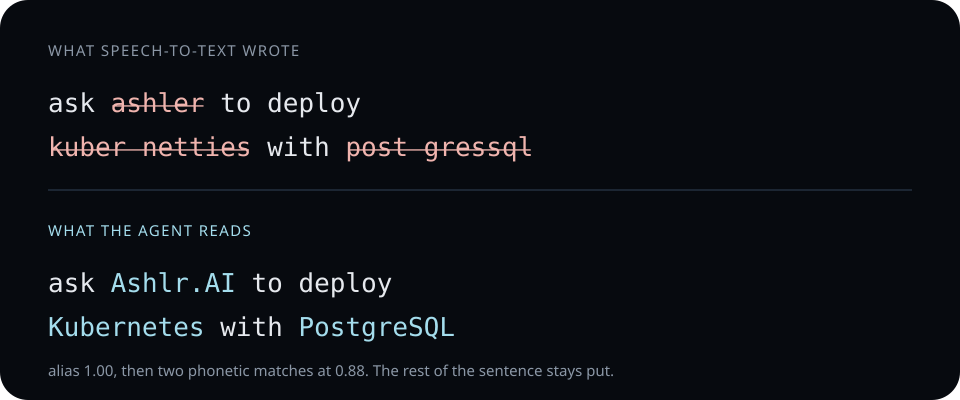
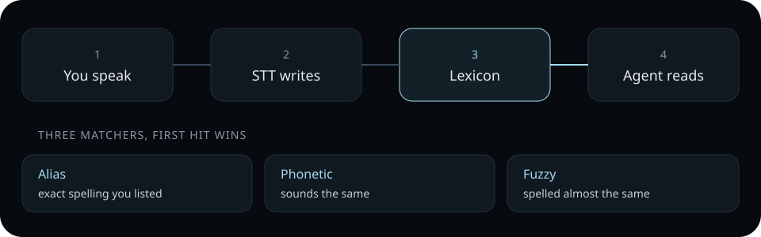
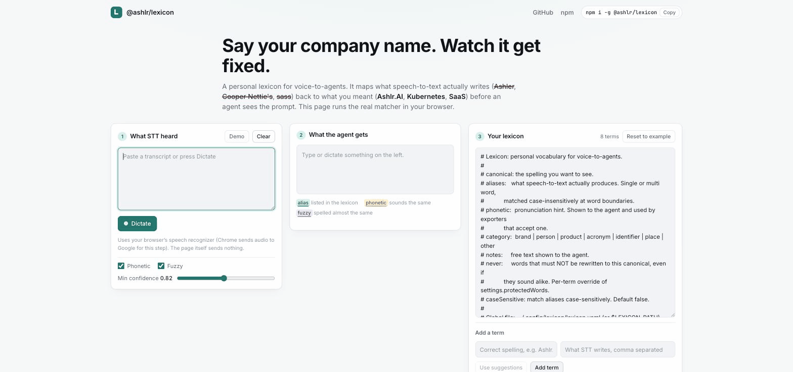
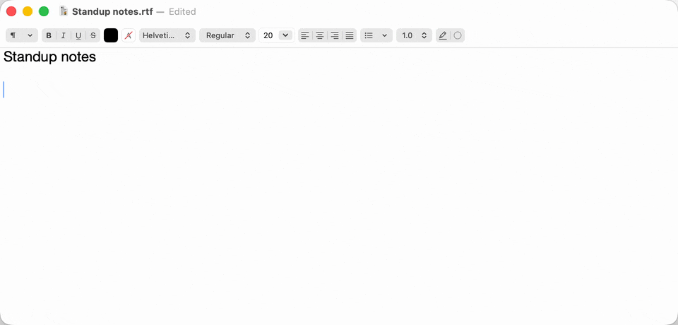

<div align="center">


# Lexicon

**Speech-to-text gets English right and your names wrong.**

Lexicon is one YAML file of the words you actually say. It rewrites the transcript before an agent reads it. It is not a dictation app.

[](https://github.com/ashlrai/lexicon/actions/workflows/ci.yml)
[](https://www.npmjs.com/package/@ashlr/lexicon)
<!-- fresh:begin badge:release -->[](package.json)<!-- fresh:end -->
[](LICENSE)
[](package.json)

[**Live demo**](https://ashlrai.github.io/lexicon/) · [**Docs**](docs/README.md) · [**llms.txt**](llms.txt) · [**llms-full.txt**](llms-full.txt) · [**lexicon.ashlr.ai**](https://lexicon.ashlr.ai)

</div>

## Start here (60 seconds)

Agents are first-class users. One command checks for Node 20+, installs the CLI, and runs `lexicon setup` when it has a terminal. Without a terminal (CI, a Dockerfile), under `sudo`, or with `LEXICON_NO_SETUP=1`, it only installs and ends with `run: lexicon setup`.

```bash
curl -fsSL https://ashlrai.github.io/lexicon/install.sh | sh
```

No global install:

```bash
npx @ashlr/lexicon@latest setup
```

Do not install it unasked. Preview the plan, show it, then apply. `--dry-run` writes nothing. Stdout is one JSON document. Read `ok` first.

```bash
lexicon setup --dry-run --json
lexicon setup --yes --packs developer,ai --json
```

`--packs`, `--harvest` and `--serve` stay opt-in even with `--yes`, because each writes a lot or installs a service.



Correct one sentence. With no lexicon of your own, arguments (not piped input) are corrected against a built-in example, and stderr says so. Nothing is written.

```bash
lexicon normalize "ask ashler to deploy kuber netties with post gressql" --json
```

```json
{"ok":true,"input":"ask ashler to deploy kuber netties with post gressql","output":"ask Ashlr.AI to deploy Kubernetes with PostgreSQL","replacements":[{"start":4,"end":10,"original":"ashler","replacement":"Ashlr.AI","canonical":"Ashlr.AI","reason":"alias","confidence":1},{"start":21,"end":34,"original":"kuber netties","replacement":"Kubernetes","canonical":"Kubernetes","reason":"phonetic","confidence":0.8826923076923077},{"start":40,"end":52,"original":"post gressql","replacement":"PostgreSQL","canonical":"PostgreSQL","reason":"phonetic","confidence":0.8795454545454546}],"changed":true,"example":true}
```

`example: true` means those terms are the built-in sample, not the user's file yet.

Add the spelling, still as JSON:

```bash
lexicon add Ashlr.AI Ashler Ashlar "Ashler AI" --phonetic ASH-ler --json
```

When the user corrects you, record it. `--dry-run` writes nothing.

```bash
lexicon learn --from "it's Ashlr.AI not Ashler" --dry-run --json
```

Check the install. Read `ready`, `summary` and `nextStep`.

```bash
lexicon doctor --json
```

The same contract, in one fetch: [llms.txt](llms.txt) (index) and [llms-full.txt](llms-full.txt) (install, tools, privacy, FAQ). The page written to an agent is [docs/AGENTS.md](docs/AGENTS.md). Copy-paste only, no commentary: [docs/COPY-PASTE.md](docs/COPY-PASTE.md).

This tree is source version <!-- fresh:begin pin:version -->0.5.10<!-- fresh:end -->. At this candidate's 2026-11-06 preparation, npm `latest` was 0.5.8. Check `lexicon --version` and `npm view @ashlr/lexicon version` before you pin.

## MCP server

Preview, then write. Without `--apply`, nothing is written. `--json` returns `{ ok, client, scope, applied, written, output }`.

```bash
lexicon install claude --json
lexicon install claude --apply --json
lexicon install cursor --json
lexicon install cursor --apply --json
lexicon install codex --json
lexicon install codex --apply --json
```

Paste these only when `lexicon-mcp` is already on `PATH` (a global install). `lexicon install` writes the path that matches how Lexicon was installed, which is the safer call.

Claude Code, Cursor (`~/.cursor/mcp.json`), and any other client that reads `mcpServers`:

```json
{
  "mcpServers": {
    "lexicon": {
      "command": "lexicon-mcp",
      "args": []
    }
  }
}
```

Codex (`~/.codex/config.toml`):

```toml
[mcp_servers.lexicon]
command = "lexicon-mcp"
args = []
```

Claude Code also gets a `SessionStart` hook and a `UserPromptSubmit` hook from `lexicon install claude --apply`. Restart the client after `--apply`. Cursor needs a window reload.

Environment variables the server reads (`LEXICON_PATH`, `LEXICON_HARVEST_ROOTS`, `LEXICON_REGISTRIES` and the rest): [docs/MCP.md](docs/MCP.md#environment-variables).

These calls cover almost every session. The server has twenty-one MCP tools, three resources and two prompts. The full table is [docs/MCP.md](docs/MCP.md).

- `normalize_transcript { text }` corrects a dictated string and returns `output`, `changed` and `replacements`.
- `learn_correction { heard, meant }` records a correction the user just made.
- `add_term { canonical, aliases?, phonetic? }` adds a spelling. Omit `aliases` and the server proposes the mis-hearings.
- `setup_lexicon { apply? }` returns a plan and writes nothing until `apply: true`.
- `lexicon_doctor {}` is the structured health check. Read `ready`, `summary` and `nextStep`.

`setup_lexicon`, `install_client` and `trust_project` preview first. Do not set `LEXICON_TRUST_ALL=1` on a user's behalf.

Plugin, if you would rather not install a CLI:

```bash
claude plugin marketplace add ashlrai/lexicon
claude plugin install lexicon@ashlrai
```

## How it works



Exact alias first, then double-metaphone phonetic, then Damerau-Levenshtein fuzzy above a confidence floor. Exact hits win the span. Matches never overlap. A stoplist of common English words blocks phonetic and fuzzy guesses, but explicit aliases override it. Per-term `never` lists and `protectedWords` also restrict replacements; code spans, URLs, emails and paths are skipped by default. Every replacement reports `reason` and `confidence`.

The same sentence, as a person would read it. Replacements go to stderr. The corrected line is stdout.

```bash
lexicon normalize --diff "ask ashler to deploy kuber netties with post gressql"
# stderr:  lexicon: no terms yet, so this is the built-in example (Ashlr.AI, Kubernetes, PostgreSQL, Pydantic, SaaS, Hetzner).
#          lexicon: run `lexicon setup` to build your own; nothing was written.
#          "ashler" -> "Ashlr.AI" (alias, 1.00)
#          "kuber netties" -> "Kubernetes" (phonetic, 0.88)
#          "post gressql" -> "PostgreSQL" (phonetic, 0.88)
# stdout:  ask Ashlr.AI to deploy Kubernetes with PostgreSQL
```

Rules: [docs/MATCHING.md](docs/MATCHING.md).

## What you get

- **One file**, `~/.config/lexicon/lexicon.yaml`. Project `.lexicon.yaml` merges only after `lexicon trust`.
- **Twenty-one MCP tools** for Claude Code, Codex, Cursor, Windsurf, Gemini CLI, VS Code and Claude Desktop.
- **A CLI with 28 commands.** `lexicon --help` lists them. `docs/CLI.md` is generated from that help.
- **271 terms across the nine packs** (developer, AI, business, voice tools, cloud and DevOps, legal profession, law and litigation, Ashlr.AI fleet, architecture). Community packs install from a registry after a checksum preview.
- **Sixteen export formats** and **eight importers**, including Wispr Flow, Superwhisper, macOS Text Replacement and espanso. `lexicon export` with no format lists them.
- **Correction in supported browser composers, eligible macOS text fields, and your own pipeline** (`normalize()`). LexiconBar requires Accessibility access and skips secure fields and apps without suitable Accessibility text support; see [its limitations](docs/MACOS-APP.md#fix-everywhere).



[Try it in the browser](https://ashlrai.github.io/lexicon/). The matcher runs on the page. The Dictate button uses the browser's speech recognizer, which in Chrome sends audio to Google.


[Watch the terminal setup recording](docs/assets/cli-setup.cast). It shows version 0.5.1; use the current [CLI reference](docs/CLI.md) for today's prompts and flags.



| Surface | How |
|---|---|
| Claude Code | `lexicon install claude --apply`, or the plugin |
| Codex | `lexicon install codex --json`, then the same command with `--apply` |
| Cursor | `lexicon install cursor --json`, then the same command with `--apply` |
| Other supported clients | `lexicon install --help` lists client names; preview with `lexicon install <client> --json` before adding `--apply` |
| Browser chats | Extension from the [latest release](https://github.com/ashlrai/lexicon/releases/latest) |
| Any macOS text field | LexiconBar menu bar app |
| Shortcuts, Raycast, your own app | `lexicon serve` on `127.0.0.1:41733` |
| Your own speech pipeline | `normalize()` between the recognizer and the model |

Which of those exist on Windows and Linux: [docs/PLATFORMS.md](docs/PLATFORMS.md).

## FAQ

### Why does dictation get my company name wrong?

The name is out of vocabulary. The recognizer picks the nearest common-sounding sequence it does know. "Ashlr.AI" becomes "Ashler". "Kubernetes" becomes "Cuban eats". The audio was fine. The vocabulary was missing. Lexicon maps the spelling you got back to the one you meant.

### How does an agent install it?

`curl -fsSL https://ashlrai.github.io/lexicon/install.sh | sh`, or `npx @ashlr/lexicon@latest setup`. Preview with `lexicon setup --dry-run --json`. The script runs setup only in a terminal. Under `sudo`, without a terminal, or with `LEXICON_NO_SETUP=1`, it prints `run: lexicon setup`.

### Does this replace Wispr Flow or Superwhisper?

No. It runs after whatever produced the transcript, and it exports into those dictionaries: `lexicon export wispr`, `lexicon export superwhisper`, `lexicon export macos`. `lexicon import` reads them back.

### Is the transcript sent anywhere?

Ordinary correction is local. There is no account, no sync and no telemetry. The CLI, hooks, MCP server, loopback API and extension do not send transcripts to a remote service. Three features use the network, and only when you turn them on: `lexicon voice` downloads a whisper.cpp model the first time (audio stays on the machine), `lexicon pack` fetches a community pack from a registry URL you choose, and the GitHub source in `lexicon import --guided` calls the GitHub API through your existing `gh` login. Email and chat are not imported. Threat model: [SECURITY.md](SECURITY.md).

### What does it cost?

Nothing. MIT license. No paid tier.

More answers: [docs/FAQ.md](docs/FAQ.md).

## Measured

On 330 clips of synthesized speech through whisper.cpp `small.en` (three voices, the same 70-term lexicon in every row), Lexicon recovered **91.0%** of the proper nouns. Raw whisper.cpp recovered 45.9%. Clean prose wrongly changed: **0 of 72**. The audio is macOS text-to-speech read into whisper.cpp, cleaner than a phone microphone. Method, the other rows, and every failing case: [docs/BENCHMARK.md](docs/BENCHMARK.md). Reproduce with `npm run bench:audio` (see [audio benchmark setup](bench/README.md)).

## Other installs

```bash
brew install ashlrai/tap/lexicon
npm i -g @ashlr/lexicon
```

Plain `brew install lexicon` is [dns-lexicon](https://github.com/dns-lexicon/dns-lexicon), a different project. Use the full tap name.

After 0.5.9 is published, <!-- fresh:begin pin:github -->`npm i -g github:ashlrai/lexicon#v0.5.10`<!-- fresh:end --> installs that tag from GitHub and builds on install.

Homebrew formula: [ashlrai/homebrew-tap](https://github.com/ashlrai/homebrew-tap). Release zips (extension, LexiconBar, checksums): [GitHub releases](https://github.com/ashlrai/lexicon/releases/latest).

`lexicon doctor --fix` previews safe repairs and writes nothing. `lexicon doctor --fix --apply` makes them, after a backup. Details: [docs/doctor-fix.md](docs/doctor-fix.md).

## Docs

| You want | Read |
|---|---|
| Commands only | [docs/COPY-PASTE.md](docs/COPY-PASTE.md) |
| Install for someone else | [docs/AGENTS.md](docs/AGENTS.md) |
| Five minutes, with what setup writes | [docs/QUICKSTART.md](docs/QUICKSTART.md) |
| Every client | [docs/CLIENTS.md](docs/CLIENTS.md) |
| Every tool | [docs/MCP.md](docs/MCP.md) |
| The index | [docs/README.md](docs/README.md) |

Changing the code: [CONTRIBUTING.md](CONTRIBUTING.md), [docs/ARCHITECTURE.md](docs/ARCHITECTURE.md).

Lexicon is one of the open-source tools from [Ashlr.AI](https://ashlr.ai). It does not need the others to run. How it sits next to Phantom: [docs/PHANTOM-USAGE.md](docs/PHANTOM-USAGE.md).

Pellucid is now part of lexicon. Pellucid's ambiguity engine - the INCOSE rule layer, span resolution and confidence calibration - lives in `src/ambiguity/`. The two-stage design it feeds is in [docs/design/two-stage-correction.md](docs/design/two-stage-correction.md).

## Roadmap and non-goals

This is not a dictation app. There is no hosted account and no sync. It is a file.

- The extension installs from the release zip. It is not in the Chrome Web Store or on Firefox Add-ons yet.
- LexiconBar is ad-hoc signed, not notarized. The first launch needs right-click and Open.
- Linux has no tray app. The Windows tray app is built and unit-tested, and it has never been run on Windows: [docs/WINDOWS-APP.md](docs/WINDOWS-APP.md).
- Double metaphone is tuned for English. Names in other languages fall back to fuzzy matching.
- The audio benchmark is text-to-speech read into whisper.cpp, not a phone microphone.

## Star Lexicon

If this stopped an agent from shipping the wrong name, star the repo. That is how the next person who dictates a company name finds it.

**[Star ashlrai/lexicon on GitHub](https://github.com/ashlrai/lexicon)**

Found a name it gets wrong? [Open a misheard term issue](https://github.com/ashlrai/lexicon/issues/new?template=misheard_term.yml).

## License

MIT. Copyright 2026 AshlrAI, Inc.
